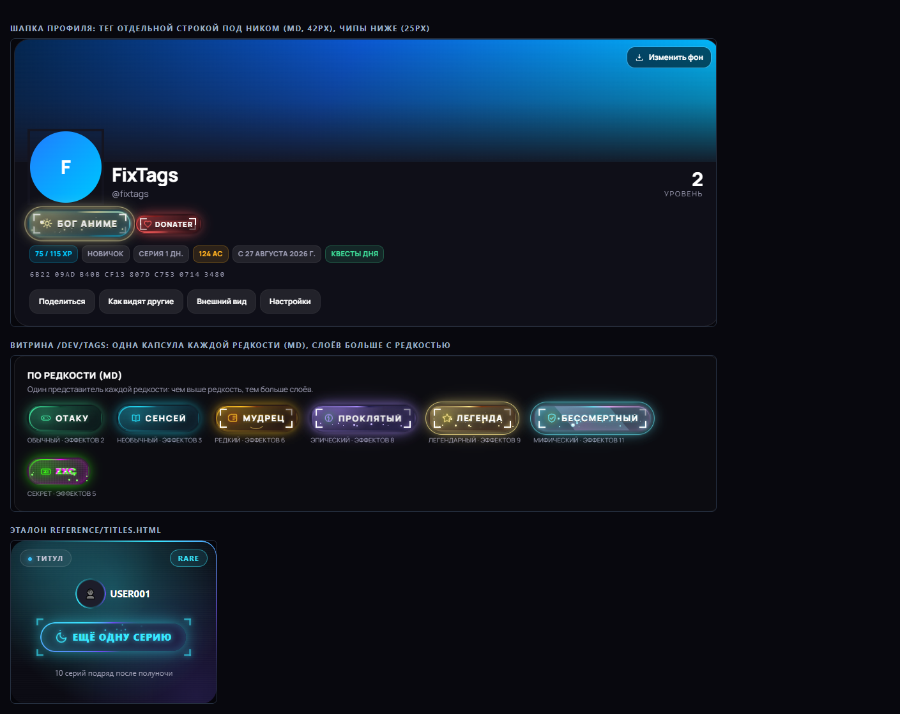

# Итоговый отчёт §16 — RPG-прогрессия AniGalaxy

Проект: `C:\Users\WHITE POWER\anime-hub` — Next.js 16 + TypeScript + Tailwind 4, тёмная тема.
Сервера и базы данных нет: все данные живут в `localStorage` браузера.
Эталон требований: `PROMPT.md` (§1–§16), референс — animeon.cc.

Все 8 этапов §15 закрыты. Ниже — состав, допущения, режим хранилища, инструкции
по расширению и известные ограничения.

---

## 1. Итоги приёмки §16

| # | Требование §16 | Результат | Чем проверено |
|---|---|---|---|
| 1 | Нет ошибок в консоли | 0 ошибок/исключений во всех CDP-прогонах | 17 скриптов слушают `Runtime.consoleAPICalled` (error) и `Runtime.exceptionThrown`; ошибки внешних CDN (`solodcdn`, `net::ERR`) отфильтрованы |
| 2 | Старые данные (уровень, XP, монеты, рамки, титулы) мигрированы без потерь, миграция идемпотентна | да | `migrate.ts` (`schemaVersion` + цепочка миграций), gain-only дельта `mergeLegacyDelta` с high-water, `tests/progression/migrate.test.mjs`, прогоны `verify_profile_cdp` |
| 3 | Каждое событие реально разблокирует достижения, видно через dev-панель | да | dev-панель `?dev=1`: `+10 EPISODES_COMPLETED` → 3 новых достижения + 2 уровня, запись `ADMIN:XP:100:dev-panel` в ledger (`prog_stage7`, 22/22) |
| 4 | Невозможно получить XP дважды за сущность; лимиты и soft-cap работают; удалённый комментарий откатывает награду | да | юнит-тесты `tests/progression/*` (**104/104**): идемпотентность по `entity`/`day`, `perDay`/`xpPerDay`, soft-cap ×0.25, реверс `COMMENT_REMOVED` |
| 5 | `tools/balance-sim`: casual/regular/hardcore, дни до 5/10/25/50/75/100, падает вне коридоров §5 | да | `node tools/balance-sim.mjs` → **22/22 OK, exit 0** (код выхода = число провалов) |
| 6 | Все 29 тегов и семейства достижений есть в данных; нет совпадающих названий тег↔достижение | да | 29 тегов, **71 достижение** в 16 семействах, 13 квестов, 21 позиция магазина; `config-data.test.mjs`, `tags.test.mjs` |
| 7 | Анимации плавные (30+ карточек), есть `prefers-reduced-motion` и режим «экономия» | да | 80 карточек в лентах главной, 178 кадров прокрутки, **0 кадров > 250 мс**; `prefers-reduced-motion` (прогон этапа 6); режим «экономия» (`prog_stage8`, 14/14) |
| 8 | Итоговый отчёт | этот файл | — |

**Дополнительно (полировка §15.8):** контраст AA на реальных элементах — 538 текстовых
узлов главной, 99 профиля, 113 модалки настроек, 196 страницы тайтла — **0 нарушений**
(`prog_stage8b`, 19/19); вёрстка 360 px без горизонтального скролла; `html[lang]`,
`<main>`, `alt` у всех 85 картинок, `aria-label` у иконочных кнопок, `:focus-visible`.

**Сводка проверок (финальная сборка: FIX_TAGS + мультивыбор + SVG-рамки + чат +
Telegram/бэкап/оптимизация):**

| Набор | Скриптов | Проверок | Провалов |
|---|---|---|---|
| Прод-регрессия: `prog_stage3…prog_stage6`, `verify5…verify7`, `verify_dialogs`, `verify_guest`, `verify_mobile`, `verify_profile_cdp`, `verify_sections` | 12 | 419 | 0 |
| Этап 8 — режим «экономия» (`prog_stage8`, prod :3010) | 1 | 14 | 0 |
| Этап 8 — полировка: контраст/a11y/360 px/производительность (`prog_stage8b`) | 1 | 19 | 0 |
| FIX_TAGS — единая капсула `ag-tag` (`prog_tags`, prod :3010) | 1 | 29 | 0 |
| Титулы косметики капсулами + Donater (`verify_titles`, prod :3010) | 1 | 11 | 0 |
| Магазин в формате каталога (`verify_shop`, prod :3010) | 1 | 16 | 0 |
| Мультивыбор тегов/титулов + SVG-рамки + чат (`verify_multi`, prod :3010) | 1 | 13 | 0 |
| Вход Telegram (демо) + бэкап/импорт/откат (`verify_auth_db`, prod :3010) | 1 | 13 | 0 |
| Этап 7 — dev-панель (`prog_stage7`, dev :3000) | 1 | 22 | 0 |
| **Итого UI-прогоны** | **20** | **556** | **0** |
| Балансовый симулятор `node tools/balance-sim.mjs` | 1 | 22 | 0 (exit 0) |
| Юнит-тесты `node tools/run-tests.mjs` | 12 файлов | 104 | 0 |

Статика: `npx tsc --noEmit` — **0**; `npx eslint src` — 5 замечаний, все
предсуществующие (`set-state-in-effect` в CatalogFilters/Header/SearchBox/WatchBox —
не относятся к прогрессии и не тронуты); `npm run build` — **0**.

---

## 2. Список файлов

### 2.1 Ядро — `src/lib/progression/`

| Файл | Назначение |
|---|---|
| `types.ts` | Схема документа (`ProgressDoc`, `schema: number`), 23 типа событий (`DomainEvent`), 10 типов эффектов (`ProgressEffect`), интерфейсы конфига (`AchievementDef`, `TagDef`, `QuestDef`, `SeasonDef`, `ShopItem`, `XpRule`, `SimConfig`, `ProgressionConfig`) |
| `progression.config.ts` | **Единственный конфиг**: уровни, soft-cap, экономика AC, правила XP (18), эры, 71 достижение, 29 тегов, квесты (8 daily + 5 weekly), магазин (21 позиция), сезоны, ранги, блок `sim` для балансового симулятора |
| `engine.ts` | Чистый движок: `applyEvent` → начисление, идемпотентность, лимиты, soft-cap, реверсы, разблокировка достижений/тегов, квесты, эры, метрики (`resolveMetrics`) |
| `service.ts` | Фасад: `emit()` (событие → документ → эффекты), побочные эффекты для профиля (`applySideEffects`: уведомления, подарок), `syncLegacyDelta()` |
| `store.ts` | `ProgressStore` — интерфейс с двумя реализациями: `LocalStore` (localStorage) и `ServerStore`-заглушка (тот же асинхронный интерфейс) |
| `migrate.ts` | Цепочка миграций по `schemaVersion` + `mergeLegacyDelta` (gain-only high-water: старый XP/монеты никогда не уменьшаются) |
| `ledger.ts` | `USER_REWARDS_LOG` — журнал наград с идемпотентными ключами и статусами `confirmed/pending/reversed` |
| `curve.ts` | Кривая уровней: `xpToNext(L) = round(50 × L^1.2)`, `totalXpFor`, `levelFromXp` |
| `time.ts` | Календарные сутки/серия: часовой пояс, DST, полночь, защита от отката часов (±5 мин) |
| `doc.ts` | Пустой документ, чтение/запись, версионирование |
| `events.ts` | React-слой: `useProgress`, `useProgressEffects`, `progressEmit` (UI не считает награды сам) |
| `achievements-view.ts` | Модель представления: ранг, трофейный счёт, «самое редкое», сегментный прогресс |
| `labels.ts`, `rarity-chips.ts`, `visual.ts` | Человекочитаемые подписи источников/типов, редкость→классы, палитры редкостей |
| `DevPanel`-логика | лежит в компоненте (см. 2.2), все операции идут через `emit()` |

### 2.2 UI — `src/components/`

| Файл | Назначение |
|---|---|
| `progression/DevPanel.tsx` | Dev-панель §14: состояние, «+N к счётчику» (14 пресетов), выдача/изъятие XP/AC с причиной, выдача тега, «Ближайшие достижения», `USER_REWARDS_LOG`, сброс документа |
| `progression/EcoBoot.tsx` | Применяет режим «экономия» → `<html data-eco>` после гидратации |
| `progression/ToastHost.tsx` | Тосты (XP 4.2 с, остальные 7 с, максимум 4), SSR-снимок без новых массивов |
| `progression/Medal.tsx`, `AgTag.tsx` | Шестигранная медаль и тег-капсула `ag-tag`: чистая `renderTag(tag, { size })`, частицы ≤16, общий `IntersectionObserver`-пауза, `prefers-reduced-motion` |
| `ProfileView.tsx`, `profile/ProfileSections.tsx`, `profile/ProfileDialogs.tsx` | Профиль: 13 разделов, модалки (журнал наград = `ProfileDialogKind = "rewards"`), настройки с переключателем «экономии» и вкладкой «Данные» (бэкап) |
| `AuthDialogHost.tsx`, `profile/ProfileDialogHostLazy.tsx` | Ленивые хосты модалок: `next/dynamic` (`ssr: false`) подключается только при открытии окна — код диалогов (в т.ч. Telegram-панель и вкладка «Данные») вне стартового бандла |
| `src/lib/backup.ts` | Локальная «БД» (§15.2): `buildBackup`/`validateBackup`/`planRestore` — чистое ядро; `exportBackup`/`importBackup`/`rollbackImport`/`storageStats` — UI-обёртки |
| `src/lib/auth.ts` | Аккаунт и Premium + `TELEGRAM_DEMO_ACCOUNTS` и `loginTelegramDemo` (демо-вход, §15.1) |
| `src/lib/eco.ts` | Стор режима «экономия» (`animehub:eco:v1`): «Авто»/«Всегда»/«Выкл», авто-детект `hardwareConcurrency ≤ 4` |
| `src/lib/toasts.ts` | Чистая функция `toastsForEffect` + стор тостов (константный `NO_TOASTS` для SSR) |
| `src/app/layout.tsx` | Хосты: `ToastHost` → `ProgressionBoot` → `DevPanel` → `EcoBoot` |
| `src/app/ag-tag.css` | **Все стили тег-капсулы** (FIX §3): ядро, 22 `.fx-*`, слои, размеры sm/md/lg, `perf-lite`/«экономия»/`prefers-reduced-motion`, кейфреймы `ag-*` |
| `src/app/effects.css`, `globals.css` | Ключевые кадры медалей, `html[data-eco="on"]`, `prefers-reduced-motion`, токен `--color-accent-deep` |

### 2.3 Инструменты и тесты

| Путь | Назначение |
|---|---|
| `tools/balance-sim.mjs` | Балансовый симулятор §16: печатает дни до уровней для трёх профилей, **падает с кодом = числу провалов** |
| `tools/run-tests.mjs` | Промежуточная `tsc` в `.tsc-tests/` → `node --test tests/progression/` (артефакты удаляются) |
| `tests/progression/*.test.mjs` | **104 юнит-теста**: engine, rewards, ledger, migrate, curve, doc, tags, ach-view, config-data (в т.ч. блок FIX: контраст AA, уникальность иконок/палитр/наборов эффектов, пол редкости), titles (титулы-капсулы, Donater), devpanel, **backup** (экспорт/валидация/план восстановления + демо-аккаунты Telegram) |
| `docs/progression/RECON.md` | Разведка референса и схемы |
| `docs/progression/PLAN.md` | План этапов с талли проверок |
| `docs/progression/ASSUMPTIONS.md` | Все допущения, принятые по ходу работы (§1–§21) |
| `docs/progression/REPORT.md` | Этот отчёт |

**Чек-скрипты UI** (CDP, headless Chrome) лежат вне репозитория —
`C:\Users\WHITE POWER\AppData\Local\Temp\opencode\`:

- прод-регрессия (12): `prog_stage3`, `prog_stage4`, `prog_stage5`, `prog_stage6`,
  `verify5`, `verify6`, `verify7`, `verify_dialogs`, `verify_guest`, `verify_mobile`,
  `verify_profile_cdp`, `verify_sections` → 419 проверок;
- dev-регрессия (1): `prog_stage7` (dev :3000) → 22 проверки;
- этап 8 (2): `prog_stage8` (режим «экономии») → 14, `prog_stage8b`
  (контраст/a11y/360 px/производительность) → 19;
- FIX_TAGS (1): `prog_tags` — ядро капсулы, пол редкости, размеры, иконки,
  контраст, reduced-motion/perf-lite/пауза, шапка, эталон, консоль → 29 проверок,
  он же снимает скриншоты в `docs/progression/shots/`;
- титулы капсулами (1): `verify_titles` — меню «Теги и титулы» (29 + 12),
  Donater, витрина «Титулы», шапка, консоль → 11 проверок + 2 скриншота;
- магазин-каталог (1): `verify_shop` — категории/счётчики, 29 тегов-карточек,
  фильтры/поиск, детальная панель («Как получить», пейджер), покупка и
  экипировка из панели, остальные категории → 16 проверок;
- мультивыбор/рамки/чат (1): `verify_multi` — теги и титулы мультивыбором,
  витрина рамок (39), экипировка рамки, чат (отправка/бейдж) → 13 проверок
  + скриншоты;
- вход Telegram и бэкап (1): `verify_auth_db` — ленивый диалог входа,
  Telegram-панель (3 демо-аккаунта, пометки «демо»/«без бота»), вход
  `@otaku_rin`, вкладка «Данные», экспорт/импорт/откат, консоль → 13 проверок
  + 2 скриншота (`auth-telegram.png`, `settings-data.png`);
- диагностика производительности: `perf_probe` (8 условий изоляции анимаций);
- разовые дампы/скриншоты: `verify3`, `verify4`, `probe_stage5`, `shot_shop`.

Итоговый прогон всех 20 скриптов: **556 проверок, 0 провалов** (`TOTAL ok=556
fail=0 sim=0`). Их можно перенести в `tools/checks/`, если скрипты потребуются
в репозитории.

---

## 3. Принятые допущения

Полный список — `ASSUMPTIONS.md`. Ключевые:

1. **Мостик «движок → профиль».** XP/уровень/AC для UI читаются **только** из документа
   прогрессии; `service.applySideEffects` пишет «Уведомления» и подарок, а
   `syncLegacyDelta()` переносит подтверждённый подарочный AC в `profile.acBalance`.
   Обратная запись документа в `profile.xp/coins` **запрещена** — иначе gain-only дельта
   считала бы XP дважды.
2. **ServerStore — заглушка** с тем же асинхронным интерфейсом: реального бэкенда в
   проекте нет, поэтому весь код уже работает через `await`, и переход на сервер —
   замена одной реализации в `store.ts`.
3. **Дев-панель вместо админки** (§14 «без бэкенда»): рендерится только при
   `process.env.NODE_ENV === "development"` **и** `?dev=1`; в production условие вырезается
   на этапе сборки.
4. **Проценты «есть у X % зрителей» не показываются** — в режиме `local` их считать не из чего.
5. **Балансовая модель симулятора** — закрытая формула (см. §6): пул одноразовых XP
   достижений копится по кривой `p^1.6`, где `p` — доля пути к L100, потому что большие
   награды сидят на поздних порогах.
6. **Тосты и журнал** — награды показываются как эффекты движка, а не считаются в UI.
7. **Пароль — баз64-хэш**, не криптографический; это честно написано и в модалке входа,
   и в профиле («сервера и базы данных у проекта нет»).
8. **Тёмная тема/палитра/бренд**: `--color-accent: #1f7bff`, `--color-accent-2: #00c8ff`,
   название — AniGalaxy, логотип — собственный инлайн-SVG, кнопки — голубой градиент.

---

## 4. Режим хранилища

Выбран `storageMode: "local"` (в `progression.config.ts`).

**Почему:** у проекта по условию нет сервера и базы данных — вся «серверная»
часть аниме-сайта это сторонний iframe Kodik с токеном, который держится только на
сервере. Хранить прогресс пользователя негде, а в `localStorage` данные доступны
мгновенно, переживают перезагрузку и не требуют аккаунта.

**Как устроено:**

- один документ `animehub:progress:v1` (`schema`, `progress`, `counters`, `daily`,
  `quests`, `achievements`, `tags`, `purchases`, `ledger`, `rejected`, `meta`);
- аккаунт — `animehub:account:v1` (пароль как баз64-хэш), профиль — `animehub:profile:v1`;
- все начисления идут через `emit()` → движок, побочные эффекты — через `service`;
- миграция при загрузке: `schemaVersion` → цепочка миграций → `mergeLegacyDelta`
  (gain-only: старые значения никогда не уменьшаются, повторный запуск ничего не меняет).

**Что это означает на практику:** данные общие для одного браузера/профиля, синхронизации
между устройствами нет, накрутка через DevTools возможна (см. §8).

**Путь к режиму `server`:** реализовать `ProgressStore` поверх HTTP в `store.ts`
(интерфейс уже асинхронный: `load/save/subscribe`), выставить `storageMode: "server"` —
тогда заработают реальные проценты владельцев, общие рейтинги и серверная проверка
heartbeat.

---

## 5. Как добавить новое

Всё балансируется **данными** (`progression.config.ts`), код менять не нужно.
После любой правки: `npx tsc --noEmit`, `node tools/run-tests.mjs`,
`node tools/balance-sim.mjs`.

### 5.1 Новое достижение

Добавить в `achievements[]`:

```ts
{
  id: "ach_example",              // только `ach_*`, уникален
  family: "episodes",             // семейство — группировка и ступень
  name: "Название",               // уникально среди достижений и не совпадает с тегами
  description: "Условие словами",
  trophy: 50,                     // трофейные очки (можно и вручную у rarity)
  rarity: "RARE",
  condition: { metric: "EPISODES_COMPLETED", threshold: 500 },
  reward: { xp: 1500, ac: 300, tagId: "tag_x" },  // tagId/frameId — опционально
  // hidden: true,                // «???» до получения
  // enabled: false,              // например, требует серверного режима
}
```

- `condition.metric` должен существовать в снапшоте `resolveMetrics()` (`engine.ts`) —
  если метрики нет, добавить её в `resolveMetrics` (или в `TODAY_METRICS`/`WEEK_METRICS`
  для дневных/недельных бакетов);
- выдача тега достижением = `reward.tagId` (тег обязан существовать с
  `source: "achievement"` или `"secret"`);
- проверить: `config-data.test.mjs` (уникальность названий, существование метрик/тегов),
  dev-панель → «Ближайшие достижения».

### 5.2 Новый тег

Добавить в `tags[]`:

```ts
{
  id: "tag_example",              // `tag_*`, уникален
  name: "Название",               // не повторяет названия достижений
  description: "Как получить",
  rarity: "EPIC",
  source: "shop",                 // "level" | "achievement" | "shop" | "event" | "secret"
  price: 2500,                    // только для source: "shop" (AC)
  // level: 25,                   // для source: "level"
  // achievementId: "ach_x",      // для "achievement" | "secret"
  // seasonId: "season_x",        // для "event"
  visual: { c: "#7c5cff", c2: "#00e0ff", effects: ["glow", "runes"], text: "neon" },
}
```

`visual.effects` — только эффекты, объявленные в `effects.css` (библиотека модулей);
`text` — `plain | glitch | neon | metal | tremor`. Любые два тега должны отличаться
минимум тремя параметрами (палитра/эффекты/текст) — это проверяют тесты.
29 капсул «по редкости» и выдача по уровню (`levelTags`) считаются из конфига автоматически.

### 5.3 Новый источник XP (правило)

Добавить в `rules`:

```ts
MY_EVENT: {
  ruleClass: "ACTIVITY",   // ACTIVITY — под soft-cap; EXEMPT — мимо
  xp: 15,
  ac: 5,                   // опционально
  repeat: "entity",        // "entity" — 1 раз на сущность; "day" — в сутки; "none" — каждый раз
  perDay: 10,              // лимит начислений в сутки
  xpPerDay: 100,           // лимит XP в сутки по правилу (для "none")
  bucket: "MY_BUCKET",     // опционально: общий счётчик для группы правил
  enabled: true,
  note: "Пояснение для dev-панели",
}
```

и событие в `DomainEvent` (`types.ts`) + обработку в `dispatch` (`engine.ts`),
после чего начислить его из UI одной строкой `progressEmit({ type: "MY_EVENT", ... })`.
Идемпотентность/лимиты/soft-cap/реверсы движок применит сам; повторное событие с тем же
идентификатором сущности уйдёт в `rejected` с причиной.

### 5.4 Новый квест

В `quests.dailyPool[]` или `quests.weeklyPool[]`:

```ts
{
  id: "qd_example",               // `qd_*` / `qw_*`
  title: "Название", description: "Что сделать",
  metric: "EPISODES_TODAY",       // ключ снапшота метрик (день/неделя — свой)
  target: 5, unit: "серий",
  xp: 60, ac: 30,
}
```

`dailyPick`/`weeklyPick` — сколько квестов выпадает в сутки/неделю (выбор детерминирован
по сиду, поэтому одинаков для всех вкладок). Прогресс квеста двигают те же события, что
и метрику; выдача — `QUEST_CLAIMED`, реверс при отмене невозможен (выдача только вручную
игроком).

### 5.5 Новый сезон

В `seasons[]` (сейчас массив пуст — сезонов нет):

```ts
{
  id: "season_new_year",
  name: "Новогодний",
  from: Date.UTC(2026, 11, 20),   // мс
  to: Date.UTC(2027, 0, 10),
  xpMultiplier: 1.5,              // только для ACTIVITY-правил, обходит cap нельзя
  acBonus: 25,                    // бонус AC к ежедневному входу
  enabled: true,
}
```

Сезонные теги ссылаются на него через `seasonId` (`source: "event"`), сезонные
достижения — обычные записи в `achievements[]` с датами в описании. Множитель сезона
не обходит ни лимиты, ни hard-cap.

### 5.6 Что прогнать после правок

```bash
npx tsc --noEmit                 # типы
node tools/run-tests.mjs         # 83 юнита
node tools/balance-sim.mjs       # коридоры §5 (падает при выходе за них)
npm run build                    # прод-сборка
# + CDP-прогоны из Temp\opencode (см. §2.3) — консоль чистая, 360 px, контраст
```

---

## 6. Баланс и симулятор

`node tools/balance-sim.mjs` — код выхода = число проваленных проверок (сейчас **0**).

**Что делает:** моделирует три профиля темпа, печатает таблицу дней до уровней
5/10/25/50/75/100 и сверяет результат с целевыми коридорами §5 (допуск ±25% —
`sim.tolerance`).

**Модель** (все числа — из `progression.config`, инструмент своих не хранит):

- кривая уровней берётся из движка (`totalXpFor`, `levelFromXp`), а не пересчитывается;
- день приносит `profile.xpPerDay` (90 / 220 / 600 — все ≤ `softCap.dailyXp` = 1000,
  иначе смягчение ломало бы модель — это проверяется);
- пул одноразовых XP достижений = сумма `reward.xp` включённых достижений (**199 150 XP**,
  68 из 71 — три требуют серверного режима);
- пул копится как `pool × p^1.6`, где `p = xpForLevel(L) / xpForLevel(100)`: поздние
  пороги (1000–2000 серий, 365 дней, 500 оценок, 10 000 минут) дают львиную долю наград,
  поэтому на середине пути получено заметно меньше половины пула;
- `days(L) = (xpForLevel(L) − накопленный_пул) / xpPerDay`.

**Итог замера** (сутки, средний темп):

| Профиль | XP/сут | ур.5 | ур.10 | ур.25 | ур.50 | ур.75 | ур.100 |
|---|---|---|---|---|---|---|---|
| Casual | 90 | 6.8 | 35 | 271 | 1161 | 2520 | 4061 |
| Regular | 220 | 2.8 | 14 | 111 | 475 | 1031 | 1661 |
| Hardcore | 600 | 1.0 | 5.3 | 41 | 174 | 378 | 609 |

Коридоры §5: regular ур.5 (2.8 в 1–3), regular ур.10 (14 в 14–21), regular ур.25
(111 в 91–152), hardcore ур.50 (174 в 213–273 → 149–341 с допуском), regular ур.50
(475 в 411–685), hardcore ур.100 (609 в 548–913). Плюс 6 опорных сумм §5
(ур.100 = 564 613 ≈ 564 600, отклонение 0.00%).

**Что крутить:** профили/цели/допуск/форма накопления — блок `sim` в
`progression.config.ts`; числа достижений — `reward.xp`; кривую — `levels.base/exponent`.

---

## 7. Производительность, a11y, режим «экономия»

- **`prefers-reduced-motion`** — глобально в `globals.css`/`effects.css`: анимации
  медалей, капсул, частиц и бликов выключаются полностью.
- **Режим «экономия»** (`src/lib/eco.ts` + `EcoBoot`): включается автоматически при
  `navigator.hardwareConcurrency ≤ 4` **или** вручную (Авто/Всегда/Выкл — переключатель
  во «Внешнем виде» настроек профиля). Состояние — `<html data-eco="on">`, гасит анимации
  и переходы так же, как системная настройка (тот же CSS-право). Выбор переживает
  перезагрузку, ручной режим важнее автоматики.
- **`IntersectionObserver`** — анимации медалей ставятся на паузу вне вьюпорта;
  частиц на предмет ≤ 16.
- **Контраст AA** — замер по реальным элементам (композитинг alpha-слоёв, парсер
  `rgb/hsl/oklab/oklch/lab/lch/color(srgb)`, для `background-clip:text` — худший стоп
  градиента): 538 + 99 + 113 + 196 элементов, **0 нарушений**. Сплошные заливки под
  белым текстом переведены на `--color-accent-deep` (производная `--color-accent` 86% +
  чёрный; белый текст на ней проходит AA — подтверждено замером), исходные
  бренд-токены не тронуты.
- **Мобильная вёрстка** — от 360 px без горизонтального скролла (`/`, `/profile`,
  `/premium`; 390 px — основной прогон `verify_mobile`).
- **Плавность** — 80 карточек в лентах главной, прокрутка 178 кадров, медианный кадр
  6 мс, 0 кадров дольше 250 мс.

---

## 8. Известные ограничения

1. **Накрутка в режиме `local`.** Данные лежат в браузере: через DevTools можно вписать
   любой XP/AC/уровень. Лимиты, идемпотентность и soft-cap защищают от *случайных*
   двойных начислений и ошибок, но не от прямого редактирования хранилища — по-настоящему
   это лечится только режимом `server` (см. §4).
2. **Один браузер = один профиль.** Нет синхронизации между устройствами; общий
   localStorage в рамках одного профиля браузера.
3. **Пароль — баз64-хэш**, не криптографический (честно указано в UI).
4. **Плеер — сторонний iframe Kodik.** Внешние ошибки его CDN попадают в консоль браузера
   (это не ошибки проекта — чек-скрипты их фильтруют), а скорость воспроизведения iframe
   не отдаёт, поэтому анти-абьюз-проверки скорости (`maxSpeed`) работают только в
   режиме `server`.
5. **Фирменные кнопки-градиенты** (`.btn-primary`, `.btn-login`, `.btn-auth-submit`):
   белый текст на ярком градиенте `#1f7bff → #00c8ff` даёт меньше 4.5:1 для мелкого
   текста. Это требование бренда («кнопки голубой градиент»), поэтому градиент оставлен;
   все *сплошные* заливки под белым текстом переведены на `--color-accent-deep` и
   проходят AA. Замер контраста покрывает `background-color` и худший стоп
   `background-clip:text`, но не оценивает фоновые градиенты кнопок.
6. **Dev-панель только в dev-сборке + `?dev=1`** — в production-бандле условие вырезается
   (проверено: `?dev=1` на :3010 панели не показывает).
7. **`service.ts` не покрыт юнит-тестами напрямую** — его поведение проверяют движок
   (96 тестов) и CDP-прогоны; чистые функции покрыты, побочные эффекты профиля — сценарно.
8. **Сезонов в данных нет** (`seasons: []`) — механизм готов и описан в §5.5, но ни один
   сезон не включён.
9. **UI-чек-скрипты не в репозитории** (см. §2.3) — они одноразовые, живут в каталоге
   временных файлов сессии.

---

## 9. FIX_TAGS: единая тег-капсула `ag-tag`

Задание `FIX_TAGS.md`, эталон — `reference/titles.html` (`.pill`): одна капсула
на весь проект, эффекты по редкости §4, 29 ручных иконок, dev-страница и
автопроверки. Менялся **только слой отображения** (`palette/icon/effects` в конфиге,
компонента, CSS): движок, хранилище, миграции, ledger и кривая XP не тронуты —
юнит-тесты и 16 CDP-прогонов идут на тех же данных.

### 9.1 Что изменилось

| Место | Было | Стало |
|---|---|---|
| Компонент | `TagCapsule.tsx` — самодельная плашка | `AgTag.tsx`: `renderTag(tag, {size})` возвращает `{spanProps, body}`, `<AgTag tag size locked/>`; слои `ag-bg/ag-soft/ag-over/ag-glow/ag-runes` рисуются только под включённые эффекты; один общий `IntersectionObserver` пишет `data-paused` прямо в DOM |
| Стили | тег-секция внутри `effects.css` (≈475 строк) | отдельный `src/app/ag-tag.css`: 22 `.fx-*`, 21 `@keyframes ag-*`, размеры sm/md/lg, `perf-lite`/`data-eco`/`prefers-reduced-motion` |
| Данные | палитры/эффекты частично | 29 тегов: `visual.icon` (24×24 stroke), эффекты в нейминге §4 (`border`, `shine`, `brackets`, `sparks`, `double`, `enter`, …), собственные слои под флейвор §8 |
| Шапка профиля | тег стоял в общей строке служебных чипов | тег — отдельной строкой под ником (`md`, 42 px), чипы ниже отдельной строкой (25 px, без анимаций) |
| Магазин / косметика | имя тега текстом | капсула `lg` в карточке (`locked`, пока не куплен) |
| Тост о выдаче | текст | капсула `sm` + `ToastInput.tagId` |
| Dev-страница | нет | `/dev/tags`: витрина по редкости + 29 × sm/md/lg + пример невыданного |

Флейвор §8 на четырёх опорных тегах: **Гуль** `#ff1744` + `glitch` + текст `glitch`;
**Вампир** бордо (`#fb7185`/`#881337`) + иконка-капля + `neon`; **Каге** тень/дым
(`mist`, `#8fb0d0`/`#0f172a`); **Шогун** золото-чёрный (`#facc15`/`#111827`) +
`double` + `metal`.

### 9.2 Список изменённых файлов

**Новые**

| Файл | Назначение |
|---|---|
| `src/components/progression/AgTag.tsx` | компонент и чистая `renderTag(tag, {size})` |
| `src/app/ag-tag.css` | все стили капсулы (ядро, эффекты, размеры, режимы, keyframes) |
| `src/app/dev/tags/page.tsx` | витрина: 7 редкостей, 29 × sm/md/lg, locked-пример |
| `docs/progression/shots/*.png` | скриншоты — их снимает прогон `prog_tags` |

**Изменённые**

| Файл | Что |
|---|---|
| `src/app/layout.tsx` | импорт `./ag-tag.css` после `effects.css` |
| `src/app/effects.css` | тег-секция вырезана (≈475 строк); в файле 474 строки: `@property --a` и 14 keyframes медалей |
| `src/lib/progression/types.ts` | `TagVisual.icon` |
| `src/lib/progression/progression.config.ts` | 29 тегов: иконки, эффекты, палитры (Каге `#64748b → #8fb0d0` ради контраста) |
| `src/lib/progression/visual.ts` | `RARITY_FLOOR`, `spinFor()`, `sparkCount()`, `PARTICLE_BUDGET` |
| `src/components/ProfileView.tsx` | тег `md` отдельной строкой под ником |
| `src/components/AccountMenu.tsx` | тег `sm` в меню пользователя |
| `src/components/profile/ProfileSections.tsx` | комментарии `sm`, магазин — капсула `lg`, `grid-cols-1` у групп (фикс переполнения 360 px, см. ниже) |
| `src/components/profile/ProfileDialogs.tsx` | «Примерочная»: тег `md` отдельной строкой, чипы ниже; косметика `lg`; «Как видят другие» `md` |
| `src/components/progression/ToastHost.tsx`, `src/lib/toasts.ts` | тост `TAG_UNLOCKED` с капсулой `sm` (`tagId`) |
| `tests/progression/config-data.test.mjs` | источник стилей → `ag-tag.css`, +6 проверок (иконки, палитры, наборы эффектов, пол редкости, контраст AA, ядро CSS) |
| `docs/progression/ASSUMPTIONS.md` | §13 — допущения FIX_TAGS |

**Удалённые:** `src/components/progression/TagCapsule.tsx` (остатков `TagCapsule` и
`.cap` в `src` — 0).

**Селекторы чек-скриптов** (вне репозитория): `prog_stage5.mjs`, `prog_stage6.mjs` —
`.cap[data-tag=…]`/`cap--locked` → `.ag-tag[data-tag=…]`/`ag-tag--locked`.

### 9.3 Автопроверки (приёмка §5)

| Пункт | Результат | Чем проверено |
|---|---|---|
| Единый компонент в 8 местах, самодельных плашек нет | да: шапка, меню, комментарии, «Как видят другие», косметика, магазин, карточки, тост — `AgTag` | grep `TagCapsule`/`.cap` по `src` = 0, CDP-замеры |
| Ядро: бегущая conic-рамка `::before`, блик, уголки, частицы, иконка, `<b>` капсом | **123/123** капсул: `conic-gradient` в `::before` и `animationName ≠ none` | `prog_tags` |
| Эффекты по редкости §4 | пол: **2 / 3 / 6 / 8 / 9 / 11 / 5** (COMMON→SECRET); частицы **0 / 0 / 0 / 10 / 14 / 16 / 8** | `prog_tags`, `config-data.test.mjs` |
| Шапка: тег отдельным `md` ≥34 px, чипы 24–26 px без анимаций | тег **42 px**, 13 px / 800 / uppercase, своей строкой; чипы **25 px**, `animationName: none` | `prog_tags` |
| Размеры sm/md/lg | высоты **31 / 42 / 50** px, шрифты 11 / 13 / 15 | `prog_tags` |
| 29 уникальных иконок 24×24 | `uniq=29`, `viewBox="0 0 24 24"`, `stroke-width: 1.7` | `prog_tags`, юнит-тест |
| `/dev/tags`: 29 × sm/md/lg | **123** капсулы, `perTag = 29` | `prog_tags` |
| `prefers-reduced-motion` выключает анимации | корень/`::before`/`::after`/текст/блик/свечение = `none`, частицы `display:none` | `prog_tags` |
| `perf-lite` скрывает частицы | частицы `display:none`, анимации `none` (включая корень — дефект найден и починен) | `prog_tags` |
| Пауза невидимых капсул | `data-paused="true"` → `animation-play-state: paused` | `prog_tags` |
| Контраст AA белого текста | **min 5.11:1** (худший — «Бог аниме» `#fff7ae/#00c8ff`) | юнит-тест + `prog_tags` |
| 30+ тегов без лагов | 123 капсулы: **0 задач >100 мс** (максимум 64 мс за окно 1.6 с); изоляция `perf_probe` (окно 2 с): было **15 задач / 1445 мс** → стало **2 задачи / 106 мс** | `prog_tags`, `perf_probe` |
| Фоллбэк без `@property` | `--a: 0deg` прямо в `.fx-border::before` + `@property --a` | юнит-тест |
| Консоль чистая | 0 ошибок/исключений (CDN-шум отфильтрован) | 16 CDP-прогонов |
| Числовое сравнение с эталоном | radius **999px**, weight **800**, **uppercase**, conic-рамка с анимацией, 4 уголка, блик, та же формула фона | `prog_tags` |

**Починка производительности.** Анимация `box-shadow` на корне (`ag-pulse`)
перекрашивала капсулу каждый кадр: изолированный замер (`perf_probe`, 8 условий)
показал, что только её отключение даёт 0 длинных задач, а отключение вращения рамки —
нет. Дыхание вынесено в слой `.ag-glow` с `opacity/transform` (композитор):
**15 задач / 1445 мс → 2 задачи / 106 мс** за 2 с наблюдения. Плюс починен дефект:
`perf-lite` и `<html data-eco="on">` гасили только детей, но не сам корень.

**Прод-фикс вёрстки.** Капсула `nowrap` раздувала auto-трек `grid gap-2 sm:grid-cols-2`
в магазине на 360–390 px (`scrollWidth` 407 при вьюпорте 390). Лечится явной колонкой
`grid-cols-1` (`minmax(0,1fr)`) — `verify_mobile` снова 12/12, ни одной вкладки с
переполнением.

### 9.4 Скриншоты

Композиция «наша шапка и витрина рядом с эталоном» — `docs/progression/shots/`:

- `fix-tags-report.png` — сводный (шапка профиля → витрина `/dev/tags` → эталон);
- `profile-header.png` — шапка: тег отдельной строкой, чипы ниже;
- `tags-showcase.png` — семь редкостей рядом;
- `reference-cards.png` — карточка эталона `reference/titles.html`.



Снимки делаются `Page.captureScreenshot` на каждом прогоне `prog_tags.mjs`, поэтому
актуальны для последней сборки.

### 9.5 Отличия от эталона и ограничения

1. **Текст капсулы белый, а не цвет `--c`** (в эталоне — цветной): `#fff` + свечение
   даёт измеримое AA на всех 29 палитрах, цветной текст на светлых палитрах — нет
   (см. ASSUMPTIONS §13).
2. **Фон взят формулы эталона** (`.pill`: `--c` 24% / `--c2` 20% на `#0b0b13`), плюс
   радиальный акцент `--c` 24% — он есть в нашем варианте и его нет в эталоне.
3. **Трекинг шире**: `letter-spacing` 0.14em против 0.06em в эталоне (у `lg` — 0.16em),
   gap 0.5em против 9 px, padding 0.8em/1.4em против 11/22 px. Каркасные числа
   (radius 999 px, weight 800, uppercase, conic-рамка, 4 уголка, блик) совпадают.
4. **Замер контраста — аналитическая модель** формулы фона из CSS (и её же держит
   юнит-тест), а не пиксельная выборка скриншота; фоновые градиенты кнопок, как и в §8
   п.5, не оцениваются.
5. **Фоллбэк без `@property` проверяется текстом CSS** (юнит-тест): в браузере без
   поддержки `@property` рамка остаётся статичной, анимации не рвутся.
6. **Частицы у MYTHIC — 16, не 18** (§4 против `particleBudget ≤ 16`), SECRET — 8;
   `icon` на RARE — про анимацию иконки, сама иконка есть у всех 29 (разметка §1).

---

## 10. Титулы косметики капсулами и Donater

Запрос после FIX_TAGS: все теги — в меню выбора («Внешний вид»/«Косметика»/
«Выбрать титул»), плоские титулы («Меценат», «Марафонец»…) сделать красивыми и
разноцветными, отдельный тег **Donater** в красном стиле.

**Что нашли разведкой (CDP):** витрина «Внешний вид» уже показывала все 29 тегов
(вкладка «Теги», 29/29 капсул). Реальный пробел был в меню «Изменить титул»
(Настройки → Внешний вид → «Выбрать титул»): только плоские одноцветные титулы,
без единого тега. Сами титулы косметики были текстом с одним `color`.

### 10.1 Что изменилось

| Место | Было | Стало |
|---|---|---|
| Данные титулов (`cosmetics.ts`) | `color` — единственный визуал | у каждого из 12 титулов `visual`: двухцветная палитра, собственный эффект, ручная иконка 24×24; конвертер `titleTag()` → `TagDef` |
| Меню «Изменить титул» | 11 плоских плашек, тегов нет | «Теги и титулы» (wide): **все 29 тегов** с экипировкой/снятием и locked-видом + **12 титулов-капсул**; внизу — закрытые с подсказкой |
| Витрина, вкладка «Титулы» | плоский текст + бейдж редкости | капсулы `md` (`locked` для неоткрытых) + бейдж |
| Шапка профиля / примерочная / «Как видят другие» | титул — плоский чип в строке служебных чипов | титул — капсула `sm` в строке тега (`md`); строка служебных чипов остаётся 24–26 px без анимаций (FIX §4) |
| Магазин, группа «Титулы» | имя текстом | капсула `md` (`locked`, пока не куплен/не открыт) |
| Donater | не было | `t-donater`: epic, за Premium, красный `#ff5c5c`/`#7f1d1d` + `flame` + `neon`, иконка-сердце |

### 10.2 Список изменённых файлов

| Файл | Что |
|---|---|
| `src/lib/cosmetics.ts` | `TitleItem.visual`, 12 титулов с палитрами/эффектами/иконками, `titleTag()`, `TITLE_TAG_RARITY`, новый `t-donater` |
| `src/components/profile/ProfileDialogs.tsx` | меню «Теги и титулы» (29+12), витрина «Титулы» капсулами, примерочная и «Как видят другие» — титул-капсула в строке тега |
| `src/components/ProfileView.tsx` | шапка: титул-капсула `sm` рядом с тегом `md`, из служебных чипов убран |
| `src/components/profile/ProfileSections.tsx` | магазин: строки титулов с капсулой `md` |
| `tests/progression/titles.test.mjs` | **+6 юнит-тестов** (на момент этапа 96/96): 12 титулов, уникальность иконок/палитр, эффекты в `ag-tag.css`, маппинг редкости, контраст AA, Donater |
| `tsconfig.tools.json` | `src/lib/cosmetics.ts` добавлен в сборку для тестов |
| Чек-скрипты (вне репозитория) | новый `verify_titles.mjs` (11 проверок + 2 скриншота); `prog_tags.mjs` — `ownLine` смягчён (тег не в строке чипов), сид с `titleId` для скриншота шапки |

Логика прогрессии, хранилище титула (`titleId`), условия открытия и 29-теговый
конфиг не менялись — снова только слой отображения.

### 10.3 Проверки

- юниты: **96/96 на момент этапа** (`titles.test.mjs`: палитры/иконки уникальны попарно, контраст
  AA ≥ 4.5 на всех 12, Donater красный);
- CDP `verify_titles`: **11/11** — меню (29 тегов + 12 титулов, locked/disabled
  для неоткрытых), выбор Donater пишет `titleId`, витрина (12×md + sm в
  примерочной), шапка (Donater sm в строке тега, `--c: #ff5c5c`, EPIC-эффекты),
  консоль чистая;
- регрессия: **17 скриптов / 510 проверок / 0 провалов**, balance-sim exit 0;
- скриншоты: `docs/progression/shots/title-dialog.png` (меню),
  `wardrobe-titles.png` (витрина «Титулы» с Donater), обновлённый
  `profile-header.png` (тег + Donater в шапке).

---

## 11. Магазин в формате каталога (референс animeon.cc/cosmetics)

Запрос: магазин — как на референсе: карточки с квадратным превью, теги с
бегущей рамкой (FIX_TAGS), все 29 тегов, описание и путь получения у каждого.

### 11.1 Что изменилось

| Элемент | Было | Стало |
|---|---|---|
| Структура | 5 панелей-групп строками | один каталог: категории **Теги 29 / Титулы 12 / Фоны 10 / Рамки 9 / Эффекты 2 / Сервисы 3** со счётчиками `owned/total` |
| Карточка | строка «имя + бейджи + кнопка» | квадрат-превью (капсула `lg` с бегущей conic-рамкой на тонированном фоне палитры; фон — градиент; рамка — аватар; эффект/сервис — иконка), замок/галочка в углу, имя капсом, редкость с цветным ромбиком, чип источника |
| Фильтры | нет | редкость (цветные ромбики, 7 ступеней) + поиск по имени |
| Детали | одна строка `description · ~N дн.` | горизонтальная панель над сеткой: большое превью, редкость, имя, описание, «Появится рядом с ником», блок **«Как получить»** (уровень N / достижение «…» / цена + ~дней / секрет / Premium), пейджер ‹ n/m ›, главное действие (Экипировать/Снять/Выбрать/Купить N AC/Применить) |
| Описания | у тегов были, у титулов — нет | у всех 12 титулов написаны свои описания (`TitleItem.description`); «как получить» выводится из данных конфига |

### 11.2 Список изменённых файлов

| Файл | Что |
|---|---|
| `src/components/profile/ProfileSections.tsx` | `ShopSection` переписан: `ShopEntry`, 6 каталогов, фильтры/поиск, карточки, детальная панель; импорты `updateProfile`, `rarityWeight`, `isUnlocked`, `TagDef` |
| `src/lib/cosmetics.ts` | `TitleItem.description` (12 текстов), `titleTag` отдаёт её в `TagDef` |

Покупки/экипировка — те же вызовы движка (`SHOP_PURCHASED`, `TAG_EQUIPPED`),
логика магазина не менялась: точные подписи кнопок (`600 AC`, `150 AC`),
сообщение «куплено за N AC» и бейдж «Куплено» сохранены — их проверяет
`prog_stage4`.

### 11.3 Проверки и решения

- **Панель сверху, а не справа**: колонка контента профиля ≈770 px — боковая
  панель 290 px оставляла карточкам по 147 px, и имена резались на 5 буквах
  (замерено CDP). Горизонтальная панель над сеткой дала карточки 249 px.
- CDP `verify_shop`: **16/16** — счётчики категорий, 29 уникальных капсул,
  `ag-spin` у рамок, 7 фильтров + «Любая», панель (пейджер/«Как получить»),
  выбор карточки, покупка тега (−500 AC) и экипировка из панели, поиск «гуль»
  → 1 результат, фильтр «Мифический» → 2, остальные категории, консоль чистая;
- регрессия на момент этапа: **18 скриптов / 526 проверок / 0 провалов**, balance-sim exit 0;
- скриншоты: `docs/progression/shots/shop-catalog.png` (витрина + панель),
  `shop-tags.png`, `shop-services.png`.

---

## 12. Мультивыбор тегов и титулов

Запрос: «можно было выбирать несколько тегов и титулов».

### 12.1 Модель

Один слот «основной» + сколько угодно «дополнительных» — движок не тронут:

| Что | Основной | Дополнительные |
|---|---|---|
| Тег | `progress.equippedTagId` (документ прогрессии, событие `TAG_EQUIPPED`) | `profile.extraTagIds: string[]` |
| Титул | `profile.titleId` | `profile.extraTitleIds: string[]` |

Правило синхронизации одно: **снятие основного → первый дополнительный
продвигается** (`UNEQUIP_TAG` + `TAG_EQUIPPED` на следующий). Дополнительные
фильтруются при чтении: без дублей основного и без неполученных тегов.
Лимиты парсинга: 28 дополнительных тегов / 11 титулов.

Такой split выбран, чтобы не менять схему документа и миграции: комментарии,
меню аккаунта, тосты и секрет «Смена облика» продолжают работать с одним
`equippedTagId` как раньше.

### 12.2 Интерфейс

- **Клик-переключатель** на карточке: не выбран → «Экипировать»/«Выбрать»
  (primary-кнопка), дополнительный → «Выбран ✓» (мятная), основной → «Снять»;
  состояния подсвечивают кольцо `ring-accent-2` (основной) / `ring-mint/60`
  (дополнительный). То же в витрине «Теги», в «Титулах», в `TitleDialog`
  («Снять все»/«Без титула» чистят оба списка) и в панели магазина.
- **Отображение**: шапка профиля, примерочная и «Как видят другие» рисуют
  ряд: основной тег `md` → дополнительные `sm` → титул `sm` → дополнительные
  титулы `sm`. Комментарии и меню аккаунта остаются с одним основным (компакт).
- Каждый посетитель чата и комментариев видит у вас основной тег — доп.
  косметика чисто ваша.

### 12.3 Файлы и проверки

| Файл | Что |
|---|---|
| `src/lib/selection.ts` | хуки `useTagSelection` / `useTitleSelection` — вся логика переключений в одном месте |
| `src/lib/profile.ts` | поля `extraTagIds`, `extraTitleIds` + парсинг |
| `src/components/ProfileView.tsx` | ряд основной+дополнительные в шапке |
| `src/components/profile/ProfileDialogs.tsx` | витрина, `TitleDialog`, примерочная, превью |
| `src/components/profile/ProfileSections.tsx` | панель магазина (состояния/действия) |

CDP `verify_multi`: **13/13** — включая «снять основного → продвижение»
(`tag_otaku` снят → основной `tag_sensei`, extras `[tag_sage]`) и шапку
`[otaku(md), sensei(sm), sage(sm)]` после выбора; юнит-тесты (на момент этапа 96/96).

---

## 13. SVG-рамки аватара (пак из 39)

Запрос: «Добавь рамки вместо нынешних, они готовые лежат здесь…».

### 13.1 Что сделано

- Прежние 8 градиентных ободков (`linear-gradient`-кольца) **заменены**
  паком `C:\Users\WHITE POWER\Desktop\фото\opencode-pack\рамки` → скопированы в
  `public/frames/frame-01.svg … frame-39.svg`: самодостаточные 512×512
  SVG-оверлеи с прозрачным центром, собственной анимацией и поддержкой
  `prefers-reduced-motion` внутри файла.
- `FrameItem` получил `img?: string` (`css` стал опциональным). `AvatarView`
  рендерит оверлей **130 %** поверх аватара — файлы рассчитаны на круг ≈77 %
  кадра, поэтому рамка обнимает аватар снаружи и не обрезается (`overflow`
  отключён для этого случая). Оверлей подключён во всех местах: шапка,
  меню аккаунта, витрина, примерочная, магазин.
- **Имена — из списка пользователя** (Кагуне, Какуган, Маска гуля, Шаринган,
  Мангекё, Риннеган, Бьякуган, Геасс, Бензопила, Драконьи шары…); две рамки
  (22 и 32) — обе «Шаринган», как в списке. У `frame-06` имя «Обратный отсчёт
  1000−7», у `frame-39` — «Шаринган → Мангекё».

### 13.2 Привязки

| Канал | Рамки |
|---|---|
| Магазин (цены сохранены) | `frame-13` «Синее пламя эго» 600 AC · `frame-24` «Проклятая энергия» 1500 AC · `frame-30` «Бензопила» 3000 AC · `frame-18` «Золотые крылья» 5000 AC |
| Достижение «Хранитель» (500 тайтлов) | `frame-14` «Король поля» (`reward.frameId`) |
| Premium / достижения / уровни | остальные: 7 common (3 сразу), 14 rare, 10 epic, 8 legendary по уровням 2–50, `watch-1`, `titles-10`, `claims-10` и т.д. |

**Старые id (`f-blue`…`f-keeper`) выпали из каталога**: сохранённые у пользователей
`frameId`/`purchased` молча не находятся → «Без рамки», данные не ломаются.

### 13.3 Проверки

- юниты: `rewards.test.mjs` переведён на `frame-13`/`frame-18`;
  `config-data.test.mjs` — `reward.frameId` обязан быть в `FRAMES` (строже прежней
  регулярки);
- CDP `verify_multi`: витрина «Рамки» — **39 SVG-оверлеев** (уникальных src 39),
  выбор `frame-22` пишет `profile.frameId`, в шапке оверлей 1.3× аватара;
- CDP `verify_shop`: категория «Рамки» — **40 карточек** (39 + «Без рамки»);
- `prog_stage4`: покупка 600 AC → «Синее пламя эго», `purchased` содержит
  `frame-13`;
- скриншот: `docs/progression/shots/frames-wardrobe.png` (витрина с новыми
  рамками).

---

## 14. Боковой онлайн-чат

Запрос: «создай онлайн чат сбоку сайта, на кнопку, которое открывалось бы как
в мессенджерах» (референс — чат animeon на скриншотах).

### 14.1 Устройство

- **Плавающая кнопка** справа внизу (иконка-пузырь, бейдж непрочитанных
  `99+`-лимит) → **панель справа**, выезжающая `translate-x` на 300 мс;
  на мобиле — во всю ширину, на десктопе — 380 px с закруглением. Закрытие —
  крестик или `Esc`.
- Панель — `role="complementary"`, **не** `dialog`: селекторы `[role="dialog"]`
  модалок проекта продолжают работать без уточнений.
- Разговор живёт в localStorage (`animehub:chat:v1`): до 100 сообщений,
  синхронизация между вкладками через событие `storage`, своё сообщение —
  `self`, рядом капсула основного тега (`ag-tag sm`), время `HH:MM`.
- **«Онлайн» симулируется честно** (серверов нет — об этом сказано в подвале
  панели): стартовая история из 9 сообщений за последний час, дальше боты
  пишут раз в 18–48 с, на своё сообщение отвечают с вероятностью 45 %
  через 2.5–7 с. Шапка показывает «N в сети».
- Гость читает свободно, писать может только после входа в аккаунт.

### 14.2 Файлы и проверки

| Файл | Что |
|---|---|
| `src/lib/chat.ts` | стор (`createLocalStore`), боты-участники с тегами прогрессии, сид истории, фоновый цикл |
| `src/components/ChatWidget.tsx` | кнопка + панель, ввод/отправка, автоскролл, бейдж |
| `src/app/layout.tsx` | монтирование в корне |

CDP `verify_multi` (чат-блок): кнопка → панель с историей (9 сообщений, 9
капсул), отправка «Всем привет из AniGalaxy!» появилась в списке и в
`localStorage` с `tagId` основного тега, закрытие → бейдж «1» на кнопке;
консоль чистая. `prog_tags` считает капсулы `/dev/tags` без учёта чата
(`[role="complementary"]` исключён из подсчёта).

Регрессия на момент этапа §14: **19 скриптов / 539 проверок / 0 провалов**;
финальные цифры после оптимизации — §15 и сводная таблица §1.

---

## 15. Вход через Telegram (демо), локальная БД и оптимизация

Запрос: «добавь кнопку авторизации через телеграмм, во вкладке входа.
Создай базу данных, чтобы всё сохранялось, если её нет. Оптимизируй сайт,
чтобы он не лагал при загрузке на хостинг, оптимизируй под мобильный
телефон все». Выбор по уточнениям: **демо-кнопка Telegram без бота** и
**локальная БД + бэкапы** (§19–§21 допущений).

### 15.1 Кнопка Telegram во вкладке «Вход»

- Под формой входа — разделитель «или» и голубая кнопка
  **«Продолжить через Telegram»** с бейджем **«демо»** и фирменным
  знаком-самолётиком (`#2AABEE` → hover `#229ED9`).
- Клик → панель выбора из трёх демо-аккаунтов (`otaku_rin`/«Рин»,
  `senpai_aki`/«Акира», `neko_yuki`/«Юки»): аватар-градиент, ник, шеврон;
  подпись «без бота: аккаунт создаётся локально», «← Назад» возвращает
  к кнопке. Выбор (`aria-label="Войти как @…"`) вызывает
  `loginTelegramDemo` → штатное создание/переключение локального аккаунта
  (email `name@t.me`, `premiumUntil` переносится), диалог закрывается —
  в шапке появляется аватар.
- Честность: подпись Login Widget без токена бота не проверить, поэтому
  «демо» видно и на кнопке, и в панели (§19).

### 15.2 Локальная «база данных»: экспорт, импорт, откат

- Модуль `src/lib/backup.ts` (чистое ядро + обёртки localStorage):
  - `buildBackup` — все ключи `animehub:*` в один JSON
    (`anigalaxy-backup-YYYY-MM-DD.json`), снимок отката в файл не попадает;
  - `validateBackup`/`parseBackup` — полная проверка **до записи**: метка
    `anigalaxy-backup`, версия, только свои ключи, значения-строки;
  - `planRestore` — сначала запись данных файла, потом удаление лишних
    ключей (восстановление = точная копия файла);
  - `importBackup` — перед применением снимок текущего состояния в
    `animehub:backup:preimport:v1` → кнопка «Откатить последний импорт»;
  - `exportBackup`/`rollbackImport`/`storageStats` — UI-обёртки с
    понятными ошибками (приватный режим, нехватка места, 8 МБ лимит файла).
- UI — **вкладка «Данные» в Настройках** (5-я вкладка): карточка
  «Локальная база данных» со статистикой («Ключей: N · объём: X КБ»),
  кнопки «Экспорт бэкапа (.json)» и «Импорт из файла», появляющаяся после
  импорта «Откатить последний импорт», скрытый `<input type="file">`.
- Автосохранение — как раньше: все сторы пишут localStorage на каждом
  изменении; бэкап добавляет защиту от потери (перенос файла на другое
  устройство, откат после неудачного импорта).

### 15.3 Оптимизация под хостинг и мобильные

- **Ленивые модалки**: `AuthDialogHost` (layout) и `ProfileDialogHostLazy`
  (шапка) монтируют `next/dynamic` (`ssr: false`) только при открытии окна —
  код диалогов вышел из стартового бандла всех страниц.
- Замер (`measure-bundles.mjs`, `/`, все `/_next/static` из HTML):
  **976,7 → 915,2 КБ raw / 304,2 → 289,3 КБ gzip**; полифил Next уходит под
  `noModule` и современными браузерами не скачивается (≈250 КБ gzip
  фактического старта `/`). Шрифт — `next/font` self-hosted, постеры —
  `loading="lazy"` (без изменений).
- **Кэш**: `headers()` в `next.config.ts` — `/frames/*` `immutable` на год,
  прочая статика — сутки с `must-revalidate`.
- **Мобильные**: `verify_mobile` расширен с 12 до 16 проверок (FAB чата
  ≥40 px в пределах экрана, панель чата во всю ширину 390 px, кнопка
  Telegram и демо-аккаунты влезают в модалку входа); tap-highlight,
  `prefers-reduced-motion` и safe-отступы были на месте с прошлых этапов.
- Проверки: CDP `verify_auth_db` — **13/13** (гость → диалог (ленивый
  хост) → Telegram-панель 3 аккаунта → вход `@otaku_rin` с email `@t.me` →
  Настройки/«Данные» → экспорт «Бэкап сохранён: N ключей» → импорт файла
  через `DOM.setFileInputFiles` (маркер из файла, лишний ключ удалён,
  аккаунт цел) → кнопка отката появилась → откат восстановил состояние до
  импорта и удалил снимок → кнопка исчезла → консоль чистая).
  Скриншоты: `shots/auth-telegram.png`, `shots/settings-data.png`.
- Статические проверки бандла `verify5`/`verify6`/`verify7` переведены на
  новую архитектуру: строки модалок («С возвращением!», «Поделиться
  профилем», «GIF», «Без титула», «Публичный профиль») теперь обязаны
  **отсутствовать** в стартовых чанках — проверка ловит случайный возврат
  к раннему импорту диалогов; честность «живёт в этом браузере» проверяется
  по тексту самой страницы профиля.

**Финальная регрессия: 20 скриптов / 556 проверок / 0 провалов**,
`balance-sim` exit 0 (22/22), юниты 104/104 (12 файлов), `tsc` 0,
eslint — ровно базлайн 5 замечаний, `npm run build` 0.

## 16. Комментарии: страница тайтла и стена профиля

Запрос: «на странице просмотра аниме и в профиле сделай комментарии
по примеру со скрина» (референс animeon.cc). Один блок, два scope
(§22 допущений).

### 16.1 Единый блок `CommentsBlock`

`src/components/comments/CommentsBlock.tsx` (client) — подключён на
странице тайтла (после «Похожих») и вместо прежней стены в разделе
профиля «Комментарии» (заголовок раздела и роутер не тронуты):

- шапка: иконка-пузырь, заголовок, счётчик всех комментариев,
  сортировка **новые/старые/популярные** (тёмный `<select>`);
- композер: плейсхолдер «Поделитесь мнением об аниме...» (тайтл) или
  «Комментарий от имени …» (стена), тумблер **Спойлер**, счётчик
  `0/300`, кнопка **Отправить**, подсказка «Ctrl+Enter — быстрая
  отправка», баннер «Ответ для …» с отменой при ответе;
- карточка: аватар с экипированной рамкой, **бейдж уровня** (градиент
  по эрам из палитры), тег автора капсулой `ag-tag` (sm), чип Premium,
  время, меню **⋮ → «Удалить»**, спойлер-маска «нажмите, чтобы
  показать», действия 👍/👎 с счётчиками и «Ответить»;
- ответы — один уровень вложенности (левая линия-отступ, компактный
  аватар), порядок ответов хронологический;
- сноска под композером честная: для тайтла — «…часть комментариев —
  демо-посев, а не живые зрители», для стены — прежняя формулировка
  «Стена локальная…».

### 16.2 Данные, награды, честность

- Тайтл-комментарии — новый локальный стор `animehub:title-comments:v1`
  (`src/lib/comments.ts`: ядро из чистых функций + обёртки). Стена
  профиля осталась на `profile.comments` — старые записи не мигрируются;
  общий тип `CommentMsg` добавляет только опциональные поля.
- **Демо-посев первого визита**: 4 комментария-персоны (один со
  спойлером, один — ответ), детерминированно от id тайтла, без событий
  движка (без наград); ключ в сторе = признак посева, удалённое всё —
  не пересеивается.
- Награды: `COMMENT_ADDED`/`COMMENT_REPLIED` из UI; `prevalidate`
  сервиса теперь сверяет **оба** хранилища (`mergeRecent`: порог 20
  символов, дубли по 5 свежим, кулдаун 60 с; ответам — только порог).
  Отклонение видимо: подсказка «Опубликовано без награды…» и флаг
  `xpGranted: false` в сторе, чтобы удаление не откатывало несуществующую
  награду (демо-посев при удалении событий не порождает).
- Движок: `COMMENT_REPLIED` теперь увеличивает `COMMENTS_VALID` —
  симметрия к `reverseComment` (удаление ответа больше не занижает
  прогресс достижений). Каскад: удаление корня уносит ответы,
  `COMMENT_REMOVED` шлётся по каждому реально награждённому id.
- Голоса 👍/👎 — локальный декор: `LIKE_*` остаются `enabled: false`
  (§6) — XP самому себе не начисляем.
- Анимации — `src/app/ag-comments.css` (включён в `layout.tsx`):
  въезд блока и карточек со stagger, «поп» голоса, blur-раскрытие
  спойлера, тёмные опции сортировки; всё гасится в `html[data-eco]`,
  `.perf-lite` и `prefers-reduced-motion`, контент при этом не прячется.

### 16.3 Проверки

- Юниты: `tests/progression/comments.test.mjs` — **+10 тестов** (114/114
  всего, 13 файлов): нормализация, слияние потоков, три сортировки,
  каскад, голоса, лимит с чисткой сирот, детерминизм демо-посева,
  29 тегов каталога, симметрия счётчика ответов в движке.
- CDP `verify_comments_cdp.mjs` — **36/36**: посев=4, плейсхолдеры,
  сортировки (обе смены порядка), спойлеры (маска → раскрытие и
  композерный), публикация (+1, без ложной ошибки качества), ответ
  через Ctrl+Enter (+1, баннер), лайк (`aria-pressed`, счётчик),
  меню «⋮» → каскад −2, стена профиля (пустое состояние, короткий
  текст с честной подсказкой, валидный без), **0 ошибок консоли**.
  Скриншоты: `comments-title.png`, `comments-profile.png`.
- Финал: регрессия **556/0**, юниты 114/114, `tsc` 0, eslint — базлайн,
  `npm run build` 0, прод `:3010` пересобран и перезапущен.
